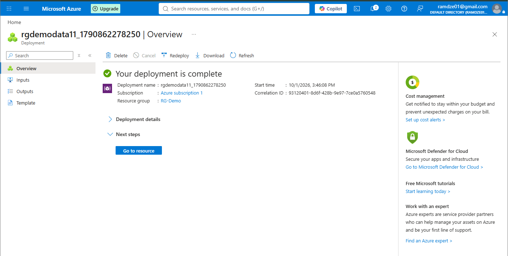
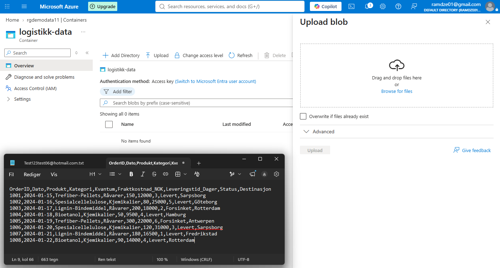
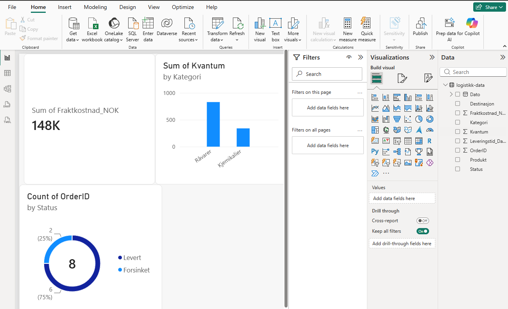

Dette prosjektet demonstrerer oppsett av en end-to-end datapipeline fra skylagring i Microsoft Azure til datamodellering og visualisering i Power BI. 

Prosjektet tar utgangspunkt i en simulert vare og logistikkflyt for råvarer og kjemikalier.

---

## Hva jeg har gjort (steg for steg)

### 1. Satt opp lagring i skyen (Azure)
Startet med å opprette en **Storage Account** i Azure-portalen for å ha et sted å gjøre av dataene min. 

### 2. Opprettet container og dumpet inn data
Opprettet containeren "logistikk-data" og lastet opp en CSV-fil med simulerte ordredata (produkter som trefiber-pellets, spesialcellelulose, fraktkostnader, destinasjoner og leveringsstatus).

### 3. Koblet til Power BI og lagde dashboard
Koblet Power BI Desktop direkte mot Azure Blob Storage med tilgangsnøkkel. Ryddet litt i dataene i Power Query og bygde tre enkle visualiseringer:
  **Total fraktkostnad**  Rask sjekk på hvor mye penger som går med til frakt.
  **Kvantum per kategori**  Oversikt over mengde råvarer vs. kjemikalier.
  **Leveringsstatus**  Smultringdiagram som viser andel leverte vs. forsinkede ordrer.

---

## Verktøy jeg har brukt
* **Microsoft Azure** (Blob Storage, Resource Groups, Access Keys)
* **Power BI Desktop** (Power Query, datamodellering og visualisering)
* **GitHub** (versjonskontroll og dokumentasjon)
