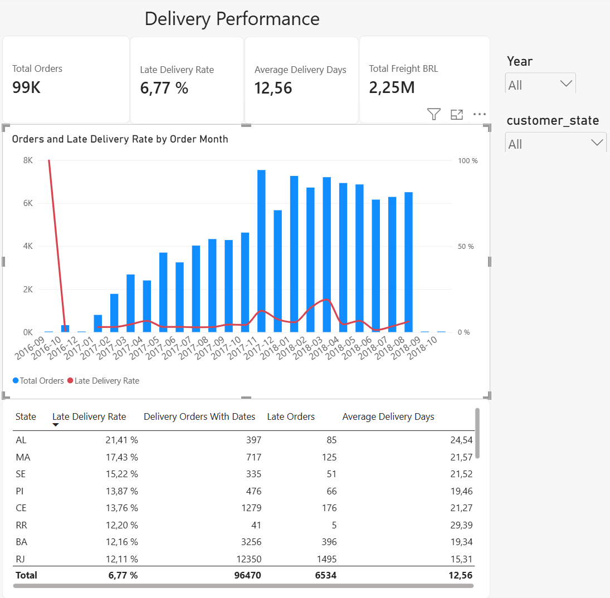
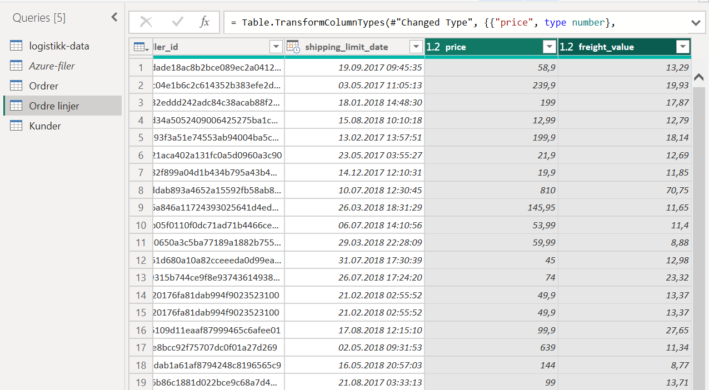
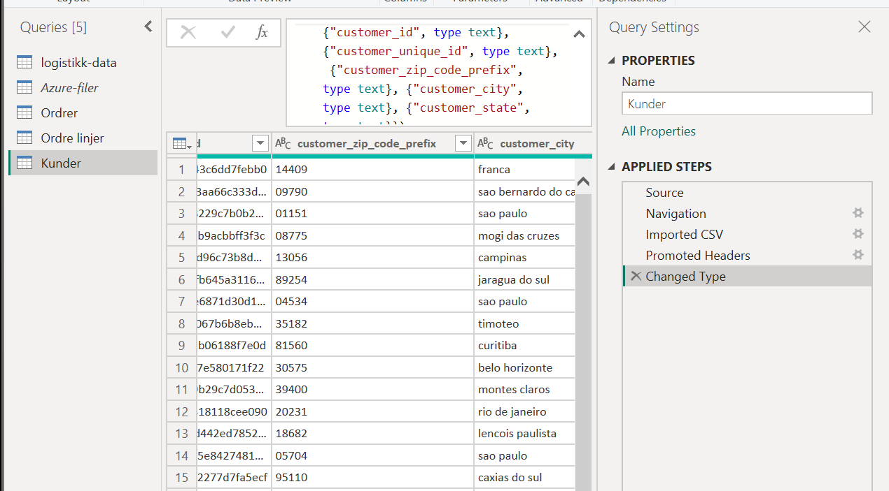
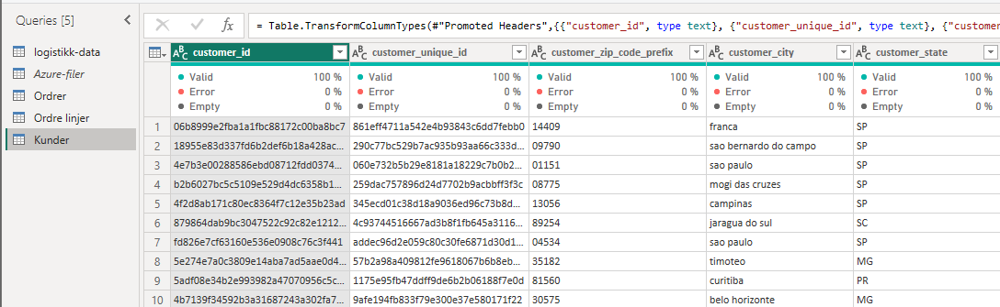
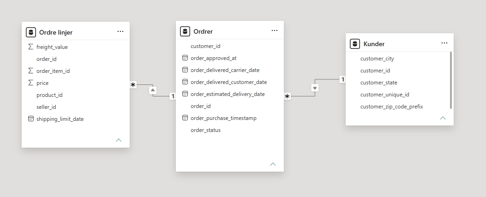
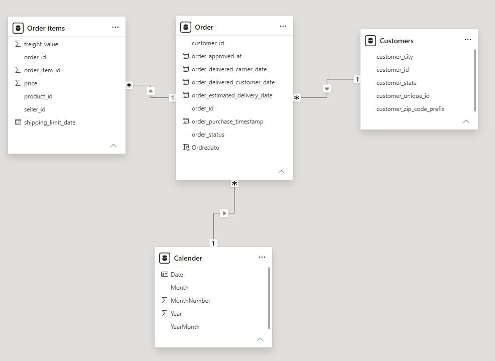
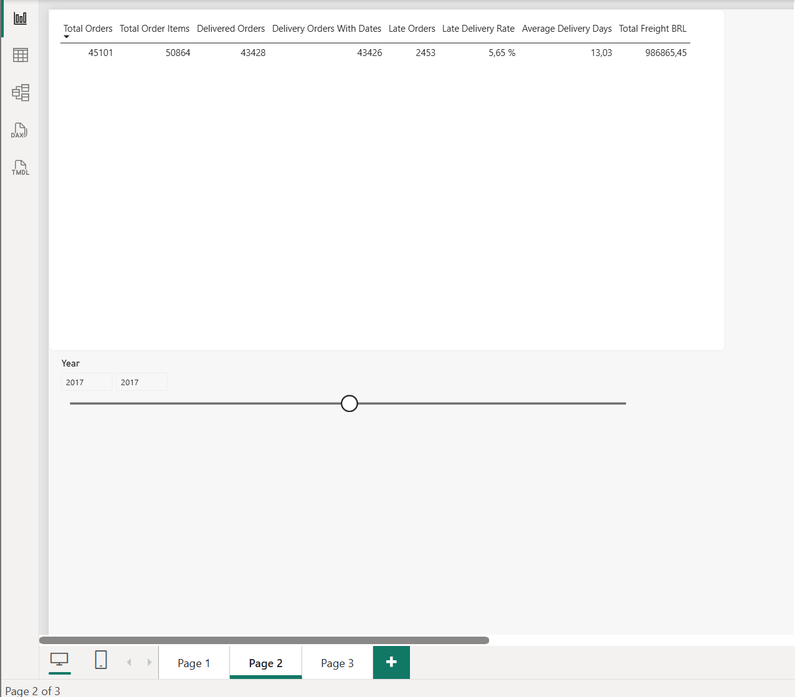
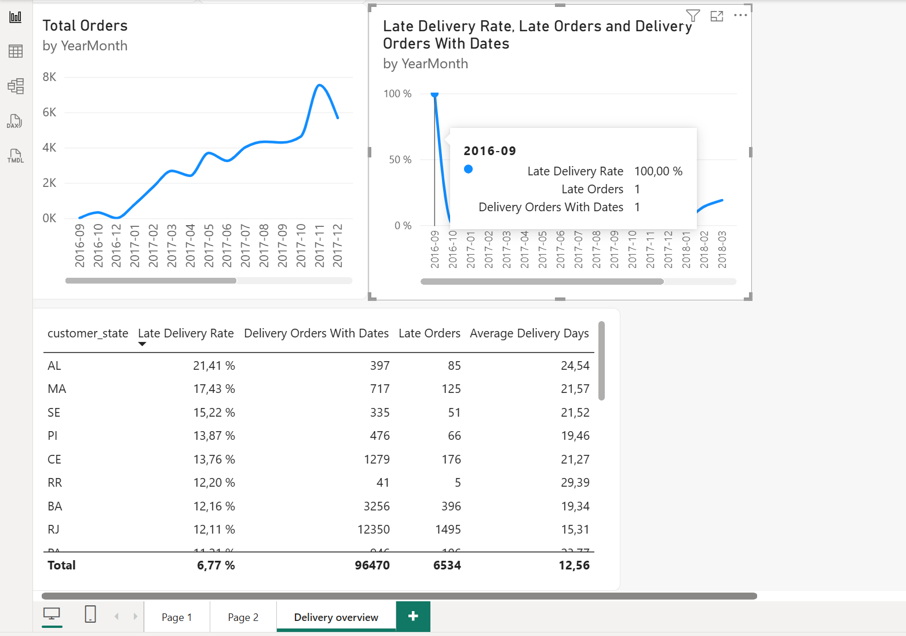
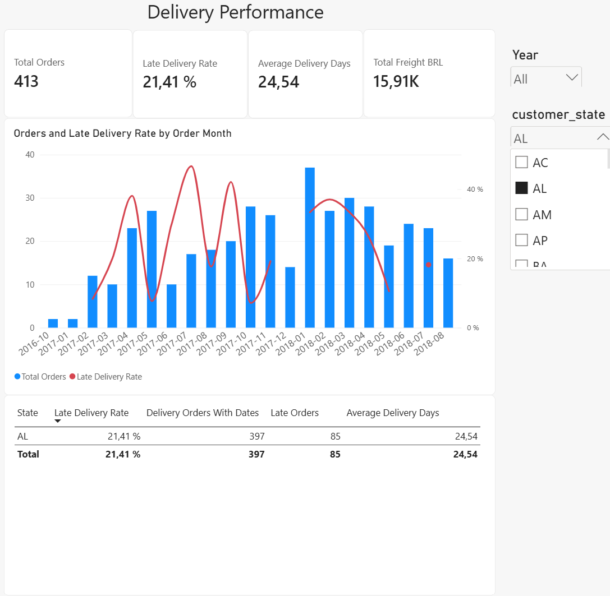

# Leveringsanalyse med Azure og Power BI

Jeg laget en rapport i Power BI for å se hvor mange ordre som ble bestilt, hvor lang tid leveringene tok og hvor mange som kom for sent. Dataene kommer fra netthandel i Brasil. Jeg hentet filene fra Azure Blob Storage, der de var lagret, og brukte dem i rapporten.

## Rapporten

Rapporten har filtre for år og delstat, fire nøkkeltall og et diagram som viser ordrevolum og forsinkelsesandel per bestillingsmåned. Tabellen under sammenligner leveringene mellom delstatene.

## Hva jeg har gjort steg for steg

### 1. Pris og fraktbeløp som tall

Power BI leste først pris og fraktbeløp som tekst. Jeg endret de to kolonnene til desimaltall, slik at jeg kunne summere beløpene. Filene bruker punktum som desimaltegn, for eksempel 13.29. Derfor valgte jeg engelsk (USA) da tallene ble lest inn. I den norske visningen står det 13,29. Beløpet er fortsatt det samme.

### 2. Postnummer som tekst

Power BI leste først postnummerprefikset som heltall. Da ble 09790 til 9790, fordi nullen foran ble fjernet. Jeg rettet det første steget som endret datatypen, og valgte tekst i stedet. Etter rettingen stod det 09790 igjen, slik det står i kildefilen. Nullen skal beholdes. Kolonnen viser starten på postnummeret, ikke hele postnummeret.

### 3. Kontroll av datakvalitet

Jeg sjekket om tabellene hadde tomme felt eller feil når Power BI leste verdiene. Kontrollen brukte først bare de første 1 000 radene. Jeg endret den til å undersøke hele tabellen. Bildet viser kundetabellen uten slike feil eller tomme felt. Noen ordre manglet leveringsdato. Jeg beholdt disse ordrene, men brukte dem ikke i beregninger som krevde datoen. En ordre-ID kunne også stå flere ganger i ordrelinjetabellen, fordi en ordre kan inneholde flere varer.

### 4. Kobling mellom tabellene

Jeg koblet kundetabellen til ordretabellen med kunde-ID, og ordretabellen til ordrelinjene med ordre-ID. Da kan Power BI finne hvilke varer som hører til en ordre, og hvilken delstat kunden tilhører. Koblingen mellom kunder og ordre var først satt til 1:1. Det passet med ID-ene i disse dataene, men jeg endret den til en til mange og filtrering en vei. Da kunne et valg av delstat filtrere både ordrene og fraktbeløpene.

### 5. Kalender og bestillingsdato

Bestillingsdatoen inneholdt også klokkeslett. Jeg laget derfor OrderDate, som bare inneholder datoen, og koblet den til en kalendertabell. Koblingen var først inaktiv. Jeg gjorde den aktiv slik at årfilteret virket. Kalenderen gjør det enklere å velge år og vise tall per måned. Jeg sorterte månedsnavnene etter månedsnummer. Året og måneden i rapporten gjelder når ordren ble bestilt, ikke når varen ble levert. Bildet viser navnene før jeg rettet dem til engelsk.

### 6. Kontroll med 2017 valgt

Kortet viste 99K, som betyr omtrent 99 000 ordre. For å se hele tallet laget jeg en kontrolltabell. Deretter valgte jeg 2017 i årfilteret. Tabellen viste 45 101 ordre, 50 864 ordrelinjer og 986 865,45 BRL i fraktbeløp. Andelen forsinkede leveringer var 5,65 %, og gjennomsnittlig leveringstid var 13,03 døgn. Både ordreantallet og fraktbeløpet endret seg. Det viste at årfilteret virket på begge tabellene.

### 7. Hvorfor september viste 100 prosent

Diagrammet viste 100 % forsinkelse for september 2016. Jeg undersøkte dette ved å vise antall leveringer og antall forsinkelser når jeg holdt pekeren over punktet. Det var bare en levert ordre med begge datoene, og den kom for sent. En forsinket levering av en gir 100 %. Tallet var altså riktig, men det betyr ikke at mange leveringer var forsinket. Jeg beholdt antallene i visningen som dukker opp over punktet.

### 8. Oversikt over leveringer

Månedene stod først i feil rekkefølge fordi diagrammet var sortert etter antall ordre. Jeg endret det slik at månedene kom i tidsrekkefølge. Deretter samlet jeg de to diagrammene. De blå søylene viser antall ordre, og den røde linjen viser andelen forsinkede leveringer. Hele datasettet har 99 441 ordre. Blant de leverte ordrene med begge leveringsdatoene kom 6,77 % for sent. Gjennomsnittlig leveringstid var 12,56 døgn. Summen av registrerte fraktbeløp var 2 251 909,54 BRL.

### 9. Kontroll med AL valgt

Jeg valgte delstaten AL og sjekket at kortene, diagrammet og tabellen viste tall for dette valget. AL hadde 413 ordre totalt. Av disse var 397 levert og hadde både faktisk og forventet leveringsdato. 85 av de 397 kom for sent. Det gir 21,41 %. Gjennomsnittlig tid fra bestilling til levering var 24,54 døgn. AL hadde en høyere forsinkelsesandel enn hele datasettet, som lå på 6,77 %. Dataene viser forskjellen, men forklarer ikke hvorfor den oppstod.

Leveringstid er tiden fra kunden bestiller til varen blir levert. En forsinket levering er en vare som kommer etter den forventede leveringsdagen. Det er altså to forskjellige ting. Fraktbeløpene er i brasilianske real (BRL). De viser frakten som er registrert på ordrelinjene, ikke hva transporten faktisk kostet selskapet.

## Data jeg har brukt

Jeg brukte disse tre CSV-filene fra [Brazilian E-Commerce Public Dataset by Olist](https://www.kaggle.com/datasets/olistbr/brazilian-ecommerce):

- `olist_orders_dataset.csv` med ordre, status og datoer.
- `olist_order_items_dataset.csv` med varer, pris og fraktbeløp per ordrelinje.
- `olist_customers_dataset.csv` med kunde-ID og geografiske opplysninger.

Dataene gjelder Brasil i perioden 2016 til 2018. Årfilteret bruker bestillingsdatoen. Forsinkelsesandelen gjelder bare leverte ordre med både faktisk og forventet leveringsdato. En levering på samme kalenderdag som forventet regnes som i tide.

## Verktøy jeg har brukt

- **Microsoft Azure** for lagring av CSV-filene i Blob Storage.
- **Power BI Desktop** for rapporten.
- **Power Query** for datatyper og kontroll av dataene.
- **DAX** for beregningene i kortene, diagrammet og tabellene.
- **GitHub** for dokumentasjon.
